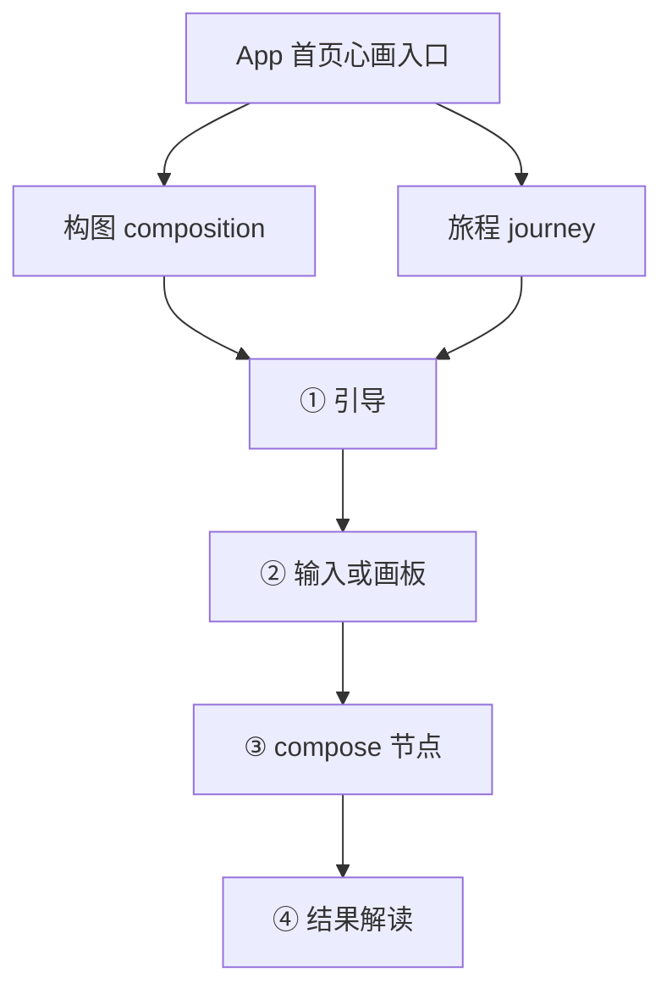
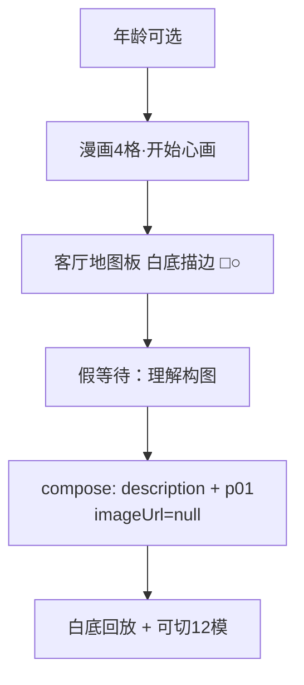
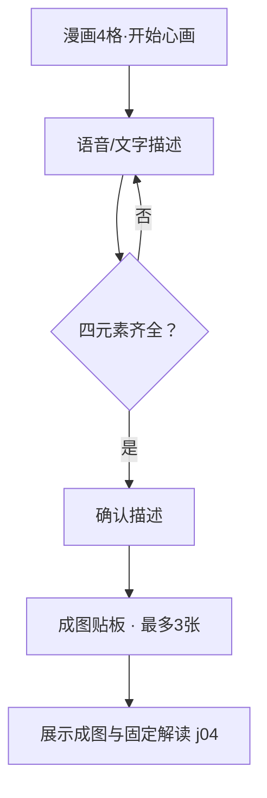

# 6Q 测评原型 · 功能清单

> 版本按时间**倒序**排列（最新在上）。当前 H5：**H5-v1.0.1**；当前 App：**v1.0.4（超级爸妈APP心画测评版本）**。

## 流程图（画板 → 模型 → 解读）

完整可交互展开版见 [`index.html#flows`](../index.html#flows)。以下为同构摘要。

### 总览（两套心画同构）

### 构图详细（v1.0.4）

### 旅程详细（v1.0.4）

## H5-v1.0.1（心画测评H5版本 · 当前）

| ID | 功能 | 状态 |
|----|------|------|
| F210 | 描述页：强化按住说话；解读出现后再出主 CTA；同页校验并直接生成（去掉中间确认页） | done |
| F211 | 结果页不对用户展示模式类型名称；`patternId` 仍写入进度/payload 供智能体 | done |
| F212 | 结果页主按钮「完成」改为「分享转发」（Share API / 复制链接演示） | done |
| F213 | 功能清单倒序展示最新版本；注释与 README 同步 | done |

入口：[`h5/entry.html`](../h5/entry.html)

## H5-v1.0.0（心画测评H5版本）

**特殊性说明**

1. 独立目录 `h5/`，与「超级爸妈APP心画测评版本」并存，互不影响。
2. 仅人生旅程；无 App 多测评首页、无构图/AQ 等入口。
3. 扫码落地 `h5/entry.html`：mock 手机号登录门禁 + 进度续测（已解读直达结果；已生图未解读提示后回 canvas）。
4. 结果页不展示课程/咨询资讯入口。
5. 登录为小程序授权手机号的 **mock**；正式待接真授权与后端。

| ID | 功能 | 状态 |
|----|------|------|
| F200 | `h5/` 独立壳：entry / login / journey-guide / canvas / result | done |
| F201 | mock「微信授权手机号」会话（`h5-auth.js`） | done |
| F202 | 按 userId 进度 none/composing/completed（`h5-progress.js`） | done |
| F203 | entry 分流：登录门禁 + 续测提示 + 结果直达 | done |
| F204 | H5 结果页隐藏课程与咨询；完成 / 重新测试（完成已由 H5-v1.0.1 改为分享转发） | done |
| F205 | `index.html` / FEATURES / README 双产品命名与特殊性说明 | done |

入口：[`h5/entry.html`](../h5/entry.html) · 设计：[`specs/2026-09-02-journey-h5-edition-design.md`](superpowers/specs/2026-09-02-journey-h5-edition-design.md)

## v1.0.4（超级爸妈APP心画测评版本）

| ID | 功能 | 状态 |
|----|------|------|
| F140 | 旅程改为语音/文字描述；删除四象征/风景/附加图案拖拽 | done |
| F141 | 四元素关键词+别称校验；缺则提示「缺少 xx」 | done |
| F142 | 确认描述 → 假等待 → 完整旅程成图贴板；描述锁定可重生（1+2=最多3张） | done |
| F143 | 旅程漫画引导文案同步新流程 | done |
| F144 | 构图交互板+结果回放：纯白底；□○ 仅描边无填充；去颜色调节 | done |
| F145 | `index.html` / 流程图升 v1.0.4 | done |

## v1.0.3

| ID | 功能 | 状态 |
|----|------|------|
| F130 | 构图漫画引导（年龄分叉文案，4 格，不可跳过，CTA「开始心画」） | done |
| F131 | 客厅关系地图板场景 + □○ 拖转（无语音/风景） | done（视觉已由 v1.0.4 迭代） |
| F132 | 假等待「理解构图」节点；compose.imageUrl 恒 null | done |
| F133 | 统一 payload 壳 `xinhua-payload.js`（构图/旅程） | done |
| F134 | 结果默认模式 + 12 模演示条可切；客厅轻换皮 | done |
| F135 | 结果页一对一跳转心理咨询三屏（导师主页/预约详情/可约时间） | done |

## v1.0.2

| ID | 功能 | 状态 |
|----|------|------|
| F120 | 人生旅程漫画翻页引导（4 格，不可跳过，CTA「开始心画」） | done |
| F121 | 治愈旅行风场景/角色静图资源（`assets/journey/`） | done |
| F122–F125 | 草坪四象征拖拽 + 语音附加 + 成图解读 | done（已被 v1.0.4 描述成图取代） |

## v1.0.1

| ID | 功能 | 状态 |
|----|------|------|
| F110 | 心画·人生旅程入口（首页第二条） | done |
| F111–F114 | 人生旅程初版链路 | done（已被后续迭代） |

## v1.0.0

| ID | 功能 | 状态 |
|----|------|------|
| F100–F107 | 版本导航 + 构图初版链路 | done（构图体验已被后续迭代） |

## v0.1.0（基线复刻）

| ID | 功能 | 状态 |
|----|------|------|
| F001–F006 | AQ 测评主路径 + 设计令牌 | done |
