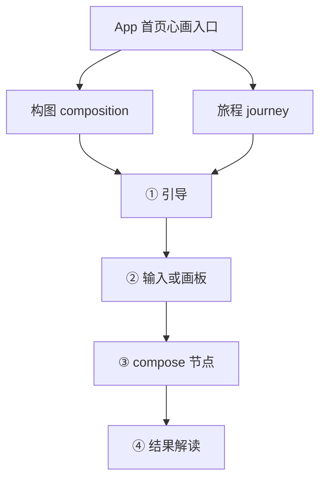
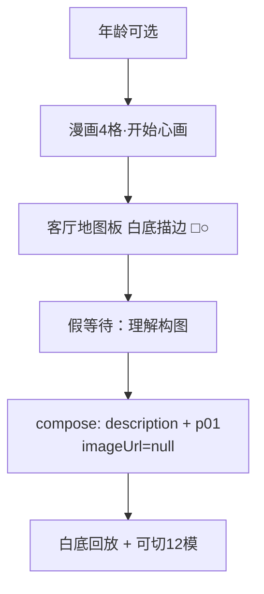
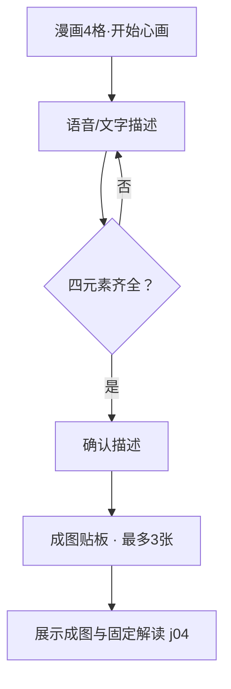

# 6Q 测评原型 · 功能清单

> 版本按时间**倒序**排列（最新在上）。当前 H5：**H5-v1.0.4**；当前 App：**v1.0.4（超级爸妈APP心画测评版本）**。

## 流程图（画板 → 模型 → 解读）

完整可交互展开版见 [`index.html#flows`](../index.html#flows)。以下为同构摘要。

### 总览（两套心画同构）

### 构图详细（v1.0.4）

### 旅程详细（v1.0.4）

## H5-v1.0.4（心画测评H5版本 · 当前）

**本版只说明留资（2026-10-13）**

| 类别 | 调整点 |
|------|--------|
| 范围 | 本版功能说明仅留资；心画与官网各一个入口 |
| 心画入口 | [`h5/journey-result.html?demo=1`](../h5/journey-result.html?demo=1) 直接进入已生成的解读页（演示数据，跳过授权/引导/成图） |
| 官网入口 | [`site-home/index.html`](../site-home/index.html) |
| 字段 | 姓氏选填；称呼单选先生/女士（默认先生）；方向单选且默认第一项；选「其他」必填说明；手机必填 |
| 安全 | 心画危机态不展示留资 |
| 数据 | 本地仅存留资字段，不绑测评上下文 |

| ID | 功能 | 状态 |
|----|------|------|
| F240 | 留资区块位置：解读之后、分享/去超级爸妈之前 | done |
| F241 | 危机态隐藏留资；结果页提供「演示：危机态（隐藏留资）」 | done |
| F242 | 方向单选且默认第一项；姓氏选填；称呼单选先生/女士且默认先生；勾其他必填自由文 | done |
| F243 | 手机必填，可预填授权号可改；须校验 11 位大陆号 | done |
| F244 | 未填手机不可提交；方向与称呼默认选中第一项 | done |
| F245 | 提交成功 toast + localStorage + 按钮「已收到，谢谢你」锁定只读 | done |
| F246 | 再进结果页恢复已提交态；footer CTA 仍可点；随单不写测评上下文 | done |

### 实现 / 验收清单（交付对照）

对照文件：`h5/journey-result.html`、`h5/js/journey-result.js`、`css/journey.css`（文件头注释含同款清单）。

- [ ] 非危机结果页可见留资；顺序为解读 → 留资 → 分享/去超级爸妈
- [ ] 点「演示：危机态（隐藏留资）」后留资消失
- [ ] 姓氏可填可不填；方向只能单选且默认「亲子沟通」；称呼只有先生/女士，默认「先生」
- [ ] 未填手机不可提交；手机须为 11 位大陆号
- [ ] 选「其他」不写字不可提交；写了可提交；placeholder 含「课程或方向」
- [ ] 有 `phoneE164` 时手机预填且可改
- [ ] 提交后 toast、按钮变「已收到，谢谢你」、不可再改；刷新仍保持
- [ ] `localStorage.journey_lead_v1` 含 `surname` / `title` / `interests`（至多一项）/ `otherText` / `phone` / `submittedAt`（无 patternId）

心画解读（直达）：[`h5/journey-result.html?demo=1`](../h5/journey-result.html?demo=1) · 官网：[`site-home/index.html`](../site-home/index.html)

### 官网首页复刻（留资插入演示）

对照源：[https://www.6qedu.com/](https://www.6qedu.com/) · 截图：[`docs/refs/6qedu-home-full.png`](refs/6qedu-home-full.png)

| 项 | 说明 |
|----|------|
| 原型入口 | [`site-home/index.html`](../site-home/index.html) |
| 插入位置 | 合作平台之后、页脚之前 |
| 合作平台 | 核心课程与留资之间；绿标题+5列 logo 墙（文字标识，非官网原图） |
| 留资口径 | 同 F240–F246（自愿 / 兴趣+手机 / 本地 `journey_lead_home_v1`） |
| 范围 | 顶栏+Hero+数据+留资+荣誉+创始人+核心课程+页脚（精简，非全站） |

## H5-v1.0.3（心画测评H5版本）

**本迭代调整说明（2026-09-15）**

| 类别 | 调整点 |
|------|--------|
| 文案 | 引导页补知情说明与情境措辞；成图页补隐私提醒、「模拟呈现」说明；结果页改为四段标题（画面观察 / 探索线索 / 积极资源 / 觉察提示）+ 固定免责结尾 |
| 呈现 | 前台不公开海报式象征预设含义；结果页展示「参与者呈现主题」`frontTheme`，不展示后台模式名（`name`/`patternId` 仅后台） |
| 安全 | 语音/文本敏感内容检测 → 开发字段 `risk_flag` / `risk_categories` / `stop_general_analysis` + 温馨提示弹层；成图页可演示 |
| 智能体 | 更新 `dify-journey-llm-prompt.md`：四段 `user_reply`、后台有模式前台无标签、禁导购/负面定论、敏感停解析；生图提示词同步禁具象化伤害 |
| 次数/CTA | 每人仅可测试一次（`MAX_RETEST=0`）；去掉「重新测试/已用尽」；改为「去6Q超级爸妈查看更多测评」→ `app-home.html` |
| 续测（沿用） | 已生图未解读：入口仍回成图页，直至查看解读；进度按授权手机号维度落库 |

| ID | 功能 | 状态 |
|----|------|------|
| F230 | 引导/成图/结果页文案对齐业务口径（知情说明、情境、隐私提醒、四段结构与免责；不改主流程） | done |
| F231 | 前台不公开海报式象征预设含义；结果页隐藏模式类型名（既有口径强化） | done |
| F232 | 敏感内容检测：`risk_flag` / `risk_categories` / `stop_general_analysis` + 温馨提示弹层 | done |
| F233 | 智能体提示词更新：四段 `user_reply`、后台有模式前台无标签、禁导购/负面定论、敏感停解析 | done |
| F234 | 结果页展示「参与者呈现主题」`frontTheme`（不展示后台模式名） | done |
| F235 | 每人仅可测试一次：去掉重新测试/用尽按钮，改为「去6Q超级爸妈查看更多测评」 | done |

入口：[`h5/entry.html`](../h5/entry.html) · 提示词：[`docs/dify-journey-llm-prompt.md`](dify-journey-llm-prompt.md) · [`docs/dify-journey-image-prompt.md`](dify-journey-image-prompt.md)

## H5-v1.0.2（心画测评H5版本）

| ID | 功能 | 状态 |
|----|------|------|
| F220 | 登录页对齐微信「手机号快速验证」UI（允许/拒绝），不展示假手机号 | done |
| F221 | 每次从 `entry` 进入强制重新授权；会话改 sessionStorage | done |
| F222 | 进度按**授权手机号**分桶统计重新测试次数（真号未回填前会话占位） | done |
| F223 | 取消「重新生成」图片；首次测完后最多还可重新测试 **2** 次 | done |
| F224 | 已生图未解读：入口强制回成图页，直至用户查看解读 | done |
| F225 | 「分享转发」= 小程序分享卡（onShareAppMessage：title/path/imageUrl）；H5 仅占位 | done |

入口：[`h5/entry.html`](../h5/entry.html)

## H5-v1.0.1（心画测评H5版本）

| ID | 功能 | 状态 |
|----|------|------|
| F210 | 描述页：强化按住说话；解读出现后再出主 CTA；同页校验并直接生成（去掉中间确认页） | done |
| F211 | 结果页不对用户展示模式类型名称；`patternId` 仍写入进度/payload 供智能体 | done |
| F212 | 结果页主按钮「完成」改为「分享转发」（Share API / 复制链接演示） | done |
| F213 | 功能清单倒序展示最新版本；注释与 README 同步 | done |

入口：[`h5/entry.html`](../h5/entry.html)

## H5-v1.0.0（心画测评H5版本）

**特殊性说明**

1. 独立目录 `h5/`，与「超级爸妈APP心画测评版本」并存，互不影响。
2. 仅人生旅程；无 App 多测评首页、无构图/AQ 等入口。
3. 扫码落地 `h5/entry.html`：每次强制微信手机号授权 + 进度续测。
4. 结果页不展示课程/咨询资讯入口。
5. 授权页对齐微信 UI，不展示假手机号；真 `getPhoneNumber` 待接。

| ID | 功能 | 状态 |
|----|------|------|
| F200 | `h5/` 独立壳：entry / login / journey-guide / canvas / result | done |
| F201 | mock「微信授权手机号」会话（`h5-auth.js`） | done |
| F202 | 按 userId 进度 none/composing/completed（`h5-progress.js`） | done |
| F203 | entry 分流：登录门禁 + 续测提示 + 结果直达 | done |
| F204 | H5 结果页隐藏课程与咨询；完成 / 重新测试（完成已由 H5-v1.0.1 改为分享转发） | done |
| F205 | `index.html` / FEATURES / README 双产品命名与特殊性说明 | done |

入口：[`h5/entry.html`](../h5/entry.html) · 设计：[`specs/2026-09-02-journey-h5-edition-design.md`](superpowers/specs/2026-09-02-journey-h5-edition-design.md)

## v1.0.4（超级爸妈APP心画测评版本）

| ID | 功能 | 状态 |
|----|------|------|
| F140 | 旅程改为语音/文字描述；删除四象征/风景/附加图案拖拽 | done |
| F141 | 四元素关键词+别称校验；缺则提示「缺少 xx」 | done |
| F142 | 确认描述 → 假等待 → 完整旅程成图贴板；描述锁定可重生（1+2=最多3张） | done |
| F143 | 旅程漫画引导文案同步新流程 | done |
| F144 | 构图交互板+结果回放：纯白底；□○ 仅描边无填充；去颜色调节 | done |
| F145 | `index.html` / 流程图升 v1.0.4 | done |

## v1.0.3

| ID | 功能 | 状态 |
|----|------|------|
| F130 | 构图漫画引导（年龄分叉文案，4 格，不可跳过，CTA「开始心画」） | done |
| F131 | 客厅关系地图板场景 + □○ 拖转（无语音/风景） | done（视觉已由 v1.0.4 迭代） |
| F132 | 假等待「理解构图」节点；compose.imageUrl 恒 null | done |
| F133 | 统一 payload 壳 `xinhua-payload.js`（构图/旅程） | done |
| F134 | 结果默认模式 + 12 模演示条可切；客厅轻换皮 | done |
| F135 | 结果页一对一跳转心理咨询三屏（导师主页/预约详情/可约时间） | done |

## v1.0.2

| ID | 功能 | 状态 |
|----|------|------|
| F120 | 人生旅程漫画翻页引导（4 格，不可跳过，CTA「开始心画」） | done |
| F121 | 治愈旅行风场景/角色静图资源（`assets/journey/`） | done |
| F122–F125 | 草坪四象征拖拽 + 语音附加 + 成图解读 | done（已被 v1.0.4 描述成图取代） |

## v1.0.1

| ID | 功能 | 状态 |
|----|------|------|
| F110 | 心画·人生旅程入口（首页第二条） | done |
| F111–F114 | 人生旅程初版链路 | done（已被后续迭代） |

## v1.0.0

| ID | 功能 | 状态 |
|----|------|------|
| F100–F107 | 版本导航 + 构图初版链路 | done（构图体验已被后续迭代） |

## v0.1.0（基线复刻）

| ID | 功能 | 状态 |
|----|------|------|
| F001–F006 | AQ 测评主路径 + 设计令牌 | done |
